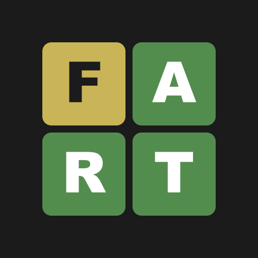

<div align="center">



# FARTLE

### The daily word ladder that always ends in one place. 💨

Change one letter at a time. Every step must be a real word.<br>
Get to **FART** in as few moves as you can.

[](https://github.com/urumb/fartle/releases/latest)
[](#-play-it)
[](#-play-it)

</div>

---

## 🎮 How to play

1. You get a starting word. Every day it's a new one.
2. Type a word that differs by **exactly one letter**. It has to be a real word.
3. Keep going until you land on **FART**.
4. Fewer steps is better. Match the shortest possible path for a **Perfect**.

Letters already in the right place for FART turn **yellow**, so you can see yourself getting close:

```
B O O B   ⬛⬛⬛⬛   start
B O O T   ⬛⬛⬛🟨   T is in place
F O O T   🟨⬛⬛🟨   F joins it
F O R T   🟨⬛🟨🟨   R too
F A R T   🟩🟩🟩🟩   💨 you made it in 4
```

Each win plays a soft chime, adds to your streak, and gives you a shareable result to show off.

## ✨ Features

- 📅 **Daily puzzle** with the same word for everyone, plus a countdown to the next one
- 🔥 **Streaks and stats** for games played, streak, best streak and perfect runs
- 🧠 **Always solvable.** The shortest path is worked out for every word, so "Perfect" means perfect
- 📋 **One-tap share** of your result
- 🔊 **Sound toggle** with a mellow win chime
- 📴 **Works offline** and installs like a real app
- 🚫 **No accounts, no ads, no tracking.** Your progress stays on your device

## 🚀 Play it

### Android
Grab **`FARTLE.apk`** from the [latest release](https://github.com/urumb/fartle/releases/latest), open it on your phone and allow installs from unknown sources.

> Already have an older version? Uninstall it first so you get the new icon.

### Desktop or web
It's a plain static site, so any file server works:

```bash
python -m http.server 5173
```

Open <http://localhost:5173>. In Chrome or Edge, use the install icon in the address bar (or **Install FARTLE** in the menu) to get its own window and a taskbar icon.

If you host the folder somewhere with HTTPS (GitHub Pages, Netlify and similar), it can be installed from there on desktop, Android and iOS, and works offline.

## 🛠 Build the Android app yourself

The Android app is a [Capacitor](https://capacitorjs.com) wrapper around the same web files in `android/`.

You need Node, JDK 17 and the Android SDK (put its path in `android/local.properties`, which is gitignored).

```bash
npm install
npm run sync                              # copy the game into the Android project
cd android
gradlew.bat assembleDebug                 # ./gradlew assembleDebug on macOS/Linux
```

The APK lands in `android/app/build/outputs/apk/debug/app-debug.apk`.

- It's debug-signed, which is fine for your own phone. Google Play needs a release-signed build.
- Capacitor is pinned to v6 because v7 needs JDK 21.
- To regenerate the launcher icons from `assets/`, run `npx capacitor-assets generate --android`.

## 🔍 How it works

| File | What it does |
| --- | --- |
| `index.html`, `style.css` | The page and its dark, tile-based look |
| `game.js` | Builds the word graph, runs a breadth-first search outward from FART to get every word's shortest distance, picks the daily start (3 to 6 steps away) from a fixed shuffled order, and handles stats and sound |
| `words.js` | The 4-letter word list, most common first |
| `sw.js`, `manifest.webmanifest` | Make it an installable, offline PWA |
| `android/`, `capacitor.config.json` | The Capacitor Android wrapper |
| `assets/`, `icons/` | Logo sources and generated icons |

Progress and stats live in your browser's `localStorage`.

## 🙏 Credits

The word list in `words.js` is derived from:

- the [ENABLE](https://github.com/dolph/dictionary) word list (public domain), filtered to 4-letter words;
- [FrequencyWords](https://github.com/hermitdave/FrequencyWords) by hermitdave (CC BY-SA 4.0), used to keep only common words and order them by frequency.

Inspired by Feetle and Poople.

<div align="center">

Made for people who can't resist a good word game. 💨

</div>
